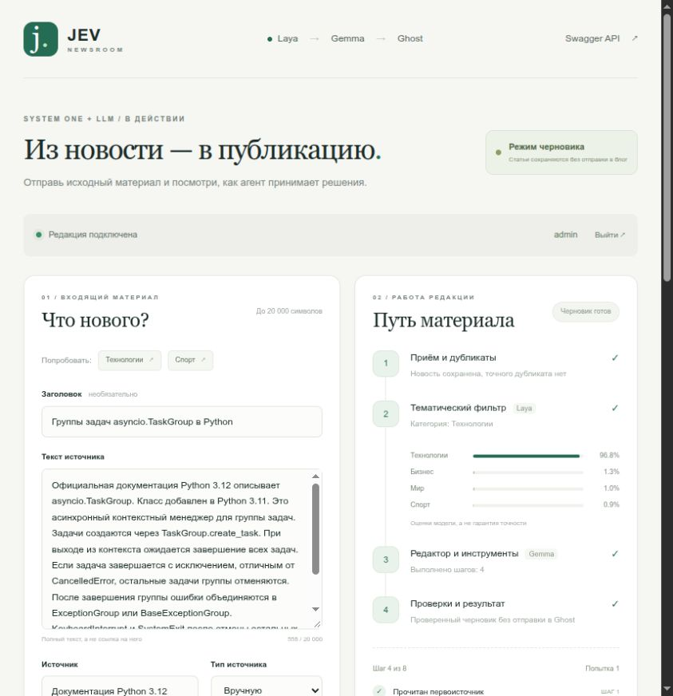

# Habr-Jev-Agent

Демо-приложение к статье о гибридной архитектуре **System One + LLM**:
от входящей технологической новости до статьи в Ghost. Laya классифицирует материал,
Gemma работает через собственный Python Agent Harness, а приложение сохраняет задачи,
проверяет результат и управляет публикацией.

Основная реализация находится в **[app/](app/README.md)**: FastAPI API, интерфейс
на Jinja2, фоновый worker и интеграции с моделями и Ghost.



## Что можно показать в демо

- Вход по логину и паролю; сессия сохраняется после обновления страницы.
- Отправку новости через браузер, Swagger или HTTP API.
- Классификацию Laya по четырём категориям и маршрутизацию до запуска Gemma.
- Отказ от явно нерелевантной новости без вызова генеративной модели.
- Работу Gemma с разрешёнными инструментами: источник, похожие новости, статья, публикация.
- Ход обработки, журнал вызовов, историю материалов и предпросмотр HTML.
- Подготовку черновика и отдельную кнопку **«Опубликовать черновик»** с новым проходом агента.
- Появление статьи на публичном Ghost-блоге и ссылку **«Открыть в блоге»** в интерфейсе.
- Обнаружение дублей, восстановление задач после перезапуска и ограниченные повторы.

## Как устроена обработка

1. **FastAPI** проверяет авторизацию и входные данные, ищет точный дубль,
   сохраняет новость и задачу восстановления в SQLite.
2. **Laya** классифицирует текст через `/v1/systemone` с решением `choice`.
   `technology`, `business` и неоднозначные результаты передаются агенту;
   однозначные `sports` и `world` пропускаются по настраиваемым порогам.
3. **Worker** получает задачу из SQLite. Lease и heartbeat позволяют восстановить
   зависшую обработку и ограничить конкурентное выполнение.
4. **Gemma** через OpenAI-совместимый API llama.cpp сама выбирает инструменты
   в пределах собственного цикла с лимитом шагов и timeout.
5. **Приложение** проверяет источник, тему подготовленного текста, сходство
   с публикациями, HTML и лимит отправок. Ghost получает сохранённый материал.

Доступны четыре инструмента: `get_source_context`, `find_similar_news`,
`save_article`, `publish_article`. Произвольного исполнения кода, shell и загрузки
страниц у агента нет. Исходная новость считается недоверенными данными.

### Два режима публикации

**`AUTO_PUBLISH=false` — режим демонстрации из `.env.example`.** Агент готовит
и проверяет статью, затем сохраняет её как `dry_run` в SQLite. Кнопка
**«Опубликовать черновик»** запускает новый проход Gemma: агент получает источник
и готовый текст, повторно проверяет материал и вызывает публикацию. Переписывать
черновик в этом проходе нельзя. Разрешение действует только на выбранную статью;
остальные новости продолжают обрабатываться как черновики.

**`AUTO_PUBLISH=true` — автоматическая публикация.** Подходящий материал проходит
весь путь до Ghost без ручного подтверждения. При недостаточных данных, отказе
модели или непройденных проверках сохраняется причина отказа или ошибки.

В Ghost статья создаётся с `status=published`, `visibility=public` и стабильным
slug. При неопределённом ответе после отправки приложение ищет её по slug;
слепой повтор POST запрещён. Повторное нажатие кнопки не создаёт ещё одну публикацию.

## Быстрый запуск приложения

Нужны Python 3.12, [uv](https://docs.astral.sh/uv/) и доступные Laya, Gemma
с поддержкой tool calling и Ghost Admin API. Веса моделей в репозитории не хранятся.

На свежем клоне:

```bash
git clone https://github.com/Yakvenalex/Habr-Jev-Agent.git
cd Habr-Jev-Agent/app
cp .env.example .env
chmod 600 .env
uv sync --frozen
```

**До запуска заполни `.env`.** Обязательные для браузерного сценария настройки:

- `WEB_USERNAME`, `WEB_PASSWORD` — собственные логин и пароль; готового публичного пароля нет.
- `WEB_SESSION_SECRET` — случайная строка длиной не менее 32 символов для подписи сессии.
- `APP_ACCESS_TOKENS` — Bearer-токены для внешних API-клиентов через запятую.
- `LAYA_BASE_URL`, `LLM_BASE_URL` — адреса моделей; у LLM адрес заканчивается на `/v1`.
- `DEV_PROXY_KEY` — ключ временного HTTPS-прокси, если он используется.
- `GHOST_URL`, `GHOST_ADMIN_API_KEY` — адрес блога и Admin API key Custom Integration
  в формате `id:secret`, необходимые для реальной публикации.
- `AUTO_PUBLISH=false` — подготовка черновиков для демонстрации.

Для генерации токена и ключа сессии:

```bash
uv run python -c 'import secrets; print("APP_ACCESS_TOKENS=" + secrets.token_urlsafe(32)); print("WEB_SESSION_SECRET=" + secrets.token_urlsafe(48))'
```

Скопируй сгенерированные значения в `.env`. Полный пример настроек —
[app/.env.example](app/.env.example). Адреса HTTPS-прокси в примере относятся
к временному стенду разработки; для воспроизведения нужны свои сервисы или доступ
к существующему стенду.

Запусти API:

```bash
uv run python -m app.main
```

В другом терминале из той же директории `app/` запусти worker:

```bash
uv run python -m app.worker
```

Открой **[http://localhost:8001/](http://localhost:8001/)** и войди с данными
из своего `.env`. **[Swagger](http://localhost:8001/docs)** доступен после входа
и использует текущую сессию. Для внешних клиентов сохранена Bearer-авторизация.
По умолчанию браузерная сессия действует 12 часов.

## Сценарий для демонстрации

1. Выбери пример **«Спорт»**, отправь его и покажи категории Laya и пропуск без Gemma.
2. Выбери **«Технологии»**: пример основан на документации `asyncio.TaskGroup`.
   Наблюдай вызовы инструментов и появление черновика.
3. Открой подготовленную статью и нажми **«Опубликовать черновик»**.
   Агент снова проверит её и при успешном результате отправит в настроенный Ghost.
4. Нажми **«Открыть в блоге»** и покажи общедоступную статью и её карточку в ленте блога.
5. Повторно отправь исходную новость: приложение вернёт существующую запись
   как дубликат до вызова Laya.

Сценарий с примерами рассчитан на чистую базу. Повторная отправка уже использованного
примера возвращает дубликат и показывает сохранённый результат. После обновления
страницы материалы можно открыть из истории. Отказ модели также отображается
в интерфейсе с причиной; генерация не гарантирует публикацию любого входного текста.

## API и Docker

Основные endpoints:

- `POST /v1/news` — принять новость; релевантная задача возвращается с HTTP 202.
- `GET /v1/news` — последние 20 материалов.
- `GET /v1/news/{id}` — новость, классификация и статус.
- `GET /v1/news/{id}/article` — подготовленная статья и возможность публикации.
- `POST /v1/news/{id}/publish` — запросить проверку и публикацию черновика агентом.
- `GET /v1/jobs/{id}` — статус, шаги, журнал инструментов, ошибка и ссылка Ghost.
- `GET /health` — процесс жив; `GET /ready` — доступность зависимостей.

Примеры запросов, семантика статусов и настройка Docker Compose —
в **[документации приложения](app/README.md)**. На сервере API и worker используют
общую SQLite в volume, а модели доступны через сеть `agent-net`. Переключение
с HTTPS-прокси на внутренние адреса Docker выполняется через окружение.

Структура репозитория:

```text
app/           FastAPI, Jinja2, worker, harness, клиенты, тесты и Compose
laya/          Compose для Laya; исходники подключены Git submodule
llm/           Compose для llama.cpp и Gemma
blog/          Compose для Ghost и MySQL
docs/images/   Иллюстрация интерфейса
```

## Проверки и границы демо

Из директории `app/`:

```bash
uv run ruff check app tests scripts
uv run ruff format --check app tests scripts
uv run pytest -q
```

Проверен 81 автоматический тест с изолированной SQLite и моками внешних сервисов:
авторизация и сессии, маршрутизация, инструменты, дубли, lease, восстановление,
лимиты, публикация и неопределённые ответы Ghost. Интеграционный тест моделей
включается отдельно:

```bash
RUN_MODEL_INTEGRATION=1 uv run pytest -q tests/test_integration.py
uv run python scripts/smoke_models.py
```

`smoke_models.py` использует временную базу и принудительный режим черновика,
не отправляя статьи в Ghost. Сценарий публикации через кнопку также проверен
с настоящими Laya, Gemma и Ghost: статья открылась публично и появилась на главной блога.

Это MVP для демонстрации архитектуры. Вероятности Laya и пороги RapidFuzz —
эвристики, требующие проверки на размеченных данных. Проверка фактов моделью
не доказывает истинность текста; внешнего поиска и независимой проверки источников
в этой версии нет. Подробности работы очереди и восстановления неопределённых
отправок описаны в [app/README.md](app/README.md).

Стек: Python 3.12, FastAPI, Jinja2, Pydantic v2, SQLAlchemy 2, SQLite WAL,
httpx, AsyncOpenAI, PyJWT, RapidFuzz, nh3. Без LangGraph, CrewAI и отдельного
брокера очередей. Секреты, базы, веса и локальное окружение исключены из Git.
